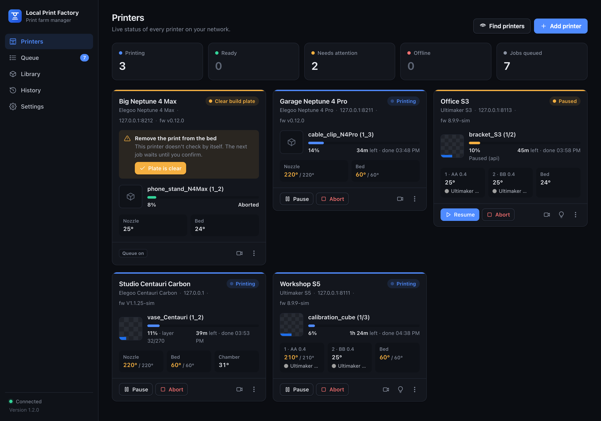

# Local Print Factory

**Run your 3D print farm from your own network.** Local Print Factory is a self-hosted replacement for
UltiMaker Digital Factory. It also manages Elegoo Neptune 4 and Centauri Carbon printers. It runs on any
always-on machine on your network, such as a Raspberry Pi, a NAS, a home server, an old PC or a Coolify
server. It talks to each printer directly, so nothing goes through the cloud.



## Features

| | |
|---|---|
| **Fleet dashboard** | Live status, progress, time left, finish time, temperatures, and the cores and materials loaded in each Ultimaker |
| **Print queue** | Upload once and queue as many copies as you like. Jobs go out top to bottom, each to the first idle printer that suits the file. You can pin a job to one printer and reorder the queue |
| **Never prints onto an old part** | Ultimakers ask on their own screen whether the build plate is clear. Elegoo printers don't, so Local Print Factory asks for them (see below) |
| **Safety checks** | A file sliced for one model is never sent to another. It warns about mismatched materials or cores, and can block those jobs instead |
| **Control** | Pause, resume, abort and camera on every printer. Ultimakers also get the light colour, an on-screen message and *identify* (blink the lights) |
| **Library** | `.ufp`, `.gcode` and `.gcode.gz` files from Cura, OrcaSlicer and ElegooSlicer, with thumbnails, print time and target printer |
| **History** | Every job with its result and a *print again* button, an event log, and each printer's own print history |
| **Notifications** | A webhook fires when a print finishes, fails or pauses, when a printer needs attention, or when one goes offline. Works with ntfy.sh, Discord, Slack and Home Assistant |
| **Hot folder** | Files saved into the hot folder are imported automatically, and can be queued automatically too |
| **API** | Everything the UI does goes through a JSON API under `/api`, with interactive docs at `/docs` |

## Supported printers

| Printer | Connection | Setup |
|---|---|---|
| UltiMaker 3 / 3 Extended, S3, S5, S7 and later S-series | The printer's local API (`/api/v1`), the same one Cura uses to connect over the network | Add it, then press **Allow** on the printer's screen to pair |
| Elegoo Neptune 4, 4 Pro, 4 Plus, 4 Max | Klipper's Moonraker API, on port 80 (the address you open Fluidd with) or 7125 | Add it by IP address and choose the exact model |
| Other Klipper / Moonraker printers | Moonraker API | Add it by IP address and type the model name your slicer writes into files |
| Elegoo Centauri Carbon | Elegoo SDCP v3: WebSocket on port 3030, uploads on 80, camera on 3031 | Add it by IP address, or use **Find printers** |

The **Centauri Carbon 2** uses a different protocol and is not supported yet.

| | Ultimaker | Neptune 4 (Klipper) | Centauri Carbon |
|---|---|---|---|
| Live status, progress, temperatures | ✓ | ✓ | ✓, plus chamber temperature and layer count |
| Pause / resume / abort | ✓ | ✓ | ✓ |
| Camera | ✓ | ✓, if a webcam is set up in Fluidd | ✓ |
| File types | `.ufp`, `.gcode`, `.gcode.gz` | `.gcode` | `.gcode` |
| Material and core checks | ✓ | – | – |
| Printer's own history | ✓ | ✓ | – |
| Lights, identify, screen message | ✓ | – | – |
| Build-plate check | The printer asks on its own screen | **Local Print Factory asks** | **Local Print Factory asks** |

### Why "Plate is clear" matters

Ultimakers won't start a new print until someone confirms the build plate is empty. Klipper printers and
the Centauri Carbon have no such check, and will start the next job on top of the last part. So after
every print on those printers, Local Print Factory holds them until someone clicks **Plate is clear** on
the printer's card. A newly added printer is held as well (**Check build plate**), because nobody has
confirmed its bed is empty yet. A print started from the printer's own screen counts as cleared.

### How files are matched to printers

A job only goes to a printer whose model matches the printer named inside the file. Cura writes this as
`;TARGET_MACHINE.NAME:`, and OrcaSlicer and ElegooSlicer write it as `printer_model`. Brand names and
spacing are ignored, so `ELEGOO NEPTUNE 4 PRO` matches *Elegoo Neptune 4 Pro*. A Neptune 4 Max file never
goes to a Neptune 4, and a `.ufp` never goes to an Elegoo. A file that doesn't name a printer is only sent
to a printer you choose for it. If no printer in your fleet can take a file, the queue says so.

## Install

> **The server must be on the same network as your printers**, or at least able to reach their IP
> addresses. Give each printer a fixed IP with a DHCP reservation in your router.

### Coolify

1. In Coolify: **+ New › Resource › Public Repository**, then paste this repository's URL.
2. Choose the **Docker Compose** build pack. The compose file is `/docker-compose.yml`.
3. Under **Environment Variables**, set `LF_PASSWORD`. Anyone who can open the page can control your
   printers.
4. Optional: set a **domain** on the `local-print-factory` service. Without one, the UI is at
   `http://<coolify-server-ip>:8800`. If port 8800 is already in use, set `LPF_PORT` to another port.
5. Click **Deploy**. The service shows *healthy* once it is up. Data is kept in the `lpf-data` volume
   across redeploys.

Prefer the **Dockerfile** build pack? Set *Ports Exposes* to `8800` and add persistent storage mounted at
`/data`.

In Coolify (bridge networking), **Find printers** can't see broadcasts on your LAN, so add printers by IP
address. Everything else works the same.

### Docker Compose

```bash
git clone https://github.com/BenTech2/local-print-factory.git
cd local-print-factory
LF_PASSWORD=choose-a-password docker compose up -d --build
```
Open `http://<server-ip>:8800`.

To let **Find printers** discover printers automatically, use host networking instead:
```bash
LF_PASSWORD=choose-a-password docker compose -f docker-compose.lan.yml up -d --build
```

### Without Docker (Python 3.11+)

```bash
./run.sh            # creates .venv, installs requirements, serves on port 8800
```

## First-time setup

1. Click **Find printers**, or **Add printer** and type in the IP address.
2. **Ultimakers:** click **Pair now**, then press **Allow** on the printer's touchscreen. Until a printer
   is paired you can watch it but not control it.
3. **Neptune 4:** if adding fails with "Moonraker refused access", add the server's IP address to
   `trusted_clients` in `moonraker.conf` (in Fluidd: *Configuration › moonraker.conf*). Or create an
   API key and enter it in the printer's settings (⋮).
4. **Elegoo printers:** check the bed is empty, then click **Plate is clear**.
5. Upload a file in **Library**, click **Print**, choose *any suitable printer* or a specific one, and set
   the number of copies.

**From your slicer:** slice with the correct printer profile, then export the file and upload it, or save
it into the hot folder. Sharing the hot folder over SMB makes this a one-step save.

## Configuration

| Variable | Default | Meaning |
|---|---|---|
| `LF_PASSWORD` | *(empty)* | Password for the UI and API. Scripts can send it as an `X-Api-Key` header. If it's empty there is no login, so only do that on a trusted LAN |
| `LF_DATA_DIR` | `./data` (`/data` in Docker) | Database, uploaded files, thumbnails, hot folder |
| `LF_HOTFOLDER` | `$LF_DATA_DIR/hotfolder` | Folder watched for new print files |
| `LF_POLL_INTERVAL` | `3` | Seconds between status checks of each printer |
| `LF_APP_NAME` | `Local Print Factory` | Name shown on the Ultimaker screen when pairing |
| `LPF_PORT` | `8800` | Host port in `docker-compose.yml` |
| `LF_SDCP_*_PORT` | 3030 / 80 / 3031 / 3000 | Centauri Carbon ports (WS / HTTP / CAM / UDP). Only change these for the simulator |

**Back up the data volume.** It holds everything, including the Ultimaker pairing keys. The health check
endpoint is `GET /healthz`.

### Security

Local Print Factory controls physical machines that heat up and move. Keep it on your LAN, or reach it
through a VPN such as Tailscale or WireGuard. Don't expose it directly to the internet. Always set
`LF_PASSWORD` if anyone else can reach the server.

## Development

```bash
python3 -m venv .venv && .venv/bin/pip install -r requirements.txt pytest
.venv/bin/pytest tests
```

There's a simulator for each printer family, so you can work on the app without hardware:
```bash
.venv/bin/python -m simulator.sim_printer   --port 8101 --name "Sim S5"         # Ultimaker (pairing auto-approves)
.venv/bin/python -m simulator.sim_moonraker --port 8201 --hostname neptune4pro  # Neptune 4 / Klipper
.venv/bin/python -m simulator.sim_sdcp      --port 8301 --udp-port 8300         # Centauri Carbon
```
Add them as `127.0.0.1:8101`, `127.0.0.1:8201` and `127.0.0.1`. The Centauri simulator needs the app
started with `LF_SDCP_WS_PORT=8301 LF_SDCP_HTTP_PORT=8301 LF_SDCP_CAM_PORT=8301 LF_SDCP_UDP_PORT=8300`.
To clear an Ultimaker simulator's build plate, run `curl -X POST localhost:8101/sim/cleanup`. To make a
sample file, run `python -m tests.make_sample cube.ufp`.

**Never point a development copy that has jobs queued at real printers.** The queue sends jobs as soon
as a matching printer appears.

```
app/main.py            web API, login, health check
app/fleet.py           polling, job tracking, queue dispatcher, notifications, hot folder
app/drivers/           one driver per printer family: ultimaker.py, moonraker.py, sdcp.py (+ base.py)
app/files.py           .ufp / gcode metadata and thumbnails
app/discovery.py       mDNS discovery
app/static/            the web UI (plain HTML/CSS/JS, no build step)
simulator/             fake printers for testing
```

The Centauri Carbon support is based on the community's reverse-engineering of SDCP, such as
[pycentauri](https://github.com/brandonrthomas/pycentauri) and the
[Elegoo Home Assistant integration](https://github.com/danielcherubini/elegoo-homeassistant).
Issues and pull requests are welcome, especially reports from real printers and firmware versions.

## License

[MIT](LICENSE)

*Not affiliated with UltiMaker or Elegoo. UltiMaker, Digital Factory, Neptune and Centauri are trademarks
of their respective owners.*
